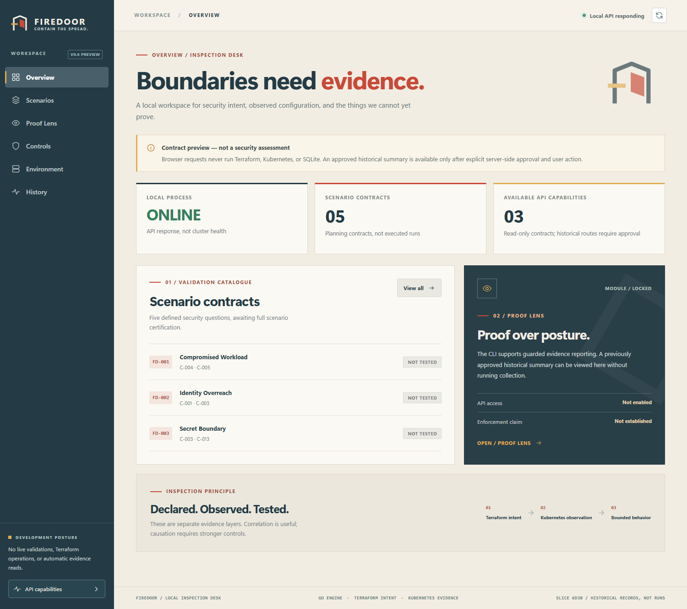

# Firedoor

**Kubernetes security is easy to declare. Proving what it actually does is harder.**

Firedoor is a **local-first Kubernetes security validation lab** that connects Terraform intent, Go-based configuration inspection, controlled network experiments, and a React evidence console. It is built to answer a practical question: **does the evidence support the security claim—or are we only looking at a configuration that *should* work?**

[](docs/screenshots/01-overview-default.png)

*Real Firedoor console in default read-only mode. API availability is not Kubernetes health or proof of enforcement.*

## Why it matters

A `NetworkPolicy` existing does not prove traffic was blocked. A failed connection does not prove the policy caused it. Firedoor keeps **declared intent, observed configuration, observed behavior, and verified conclusions** separate—so uncertainty stays visible instead of becoming a misleading green dashboard.

## What Firedoor does

- **Visualize containment:** explore three lab zones (**Edge, App, Data**) and six directed routes, comparing baseline and hardened *planning* profiles in an interactive Containment Map.
- **Inspect security controls:** use a Go CLI for scoped Kubernetes configuration audits, evidence-aware findings, and guarded lab verification workflows.
- **Connect the evidence:** examine Terraform plan receipts, Kubernetes snapshots, and historical connectivity observations in a read-only React inspection desk.
- **Show what is not proven:** distinguish `NOT TESTED`, `NOT EVALUATED`, `NOT ASSESSED`, and `INCONCLUSIVE` rather than inventing compliance scores.
- **Export guarded Boundary Proofs:** generate offline HTML/JSON reports and artifact-provenance comparisons from separately reviewed, saved sources, without claiming policy enforcement or measured security improvement.

**Concrete lab work:** the project has exercised six network paths, produced 18 security audit findings (14 PASS, 1 FAIL, 3 UNKNOWN), and recorded historical A/B/A connectivity and restoration observations. These are bounded lab results, **not independent proof of NetworkPolicy causation**.

**Stack:** Go · Kubernetes · kind · Calico · Terraform · React · TypeScript · Vite · GitHub Actions

## Run the read-only console

Requires **Go 1.27** and **Node.js 22+**. No running Kubernetes cluster or private evidence is needed for the default UI.

**Terminal 1 — from the repository root:**

```powershell
go mod download
go run ./cmd/firedoor console-api serve
```

**Terminal 2 — from the repository root:**

```powershell
cd apps/console
npm ci
npm run dev
```

Open **http://127.0.0.1:5173/** and select **Containment Map**. The console uses a localhost-only, GET-only API; historical evidence stays locked without separate server-side approval. The interface does not run scans, apply Terraform, or change cluster policy.

**Status:** v0.7 Containment Map merged to `main` in [PR #8](https://github.com/danielguillaumont/firedoor/pull/8). This is an actively developed engineering lab and portfolio demonstration—not a production scanner, continuous monitor, or certified security assessment.

**Explore the engineering:** [v0.8 offline proof-report demo (synthetic)](docs/v08-boundary-proofs-slice8e2.md) · [Architecture](docs/architecture.md) · [Demo walkthrough](docs/v06-console-demo-guide.md) · [v0.7 implementation and validation](docs/v07-containment-map-slice7e2b.md) · [Safety boundaries](SECURITY.md) · [Milestone evidence](docs/v05-validation-summary.md)
