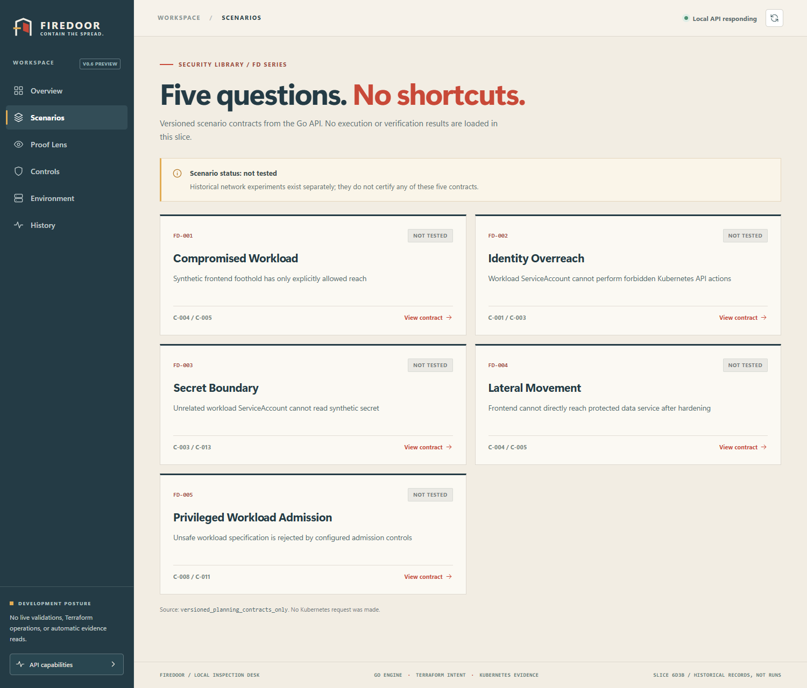
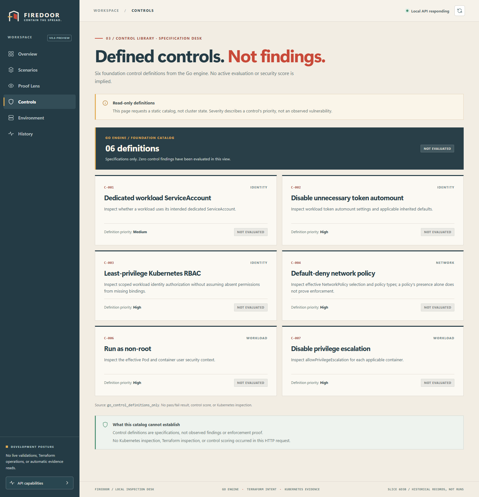
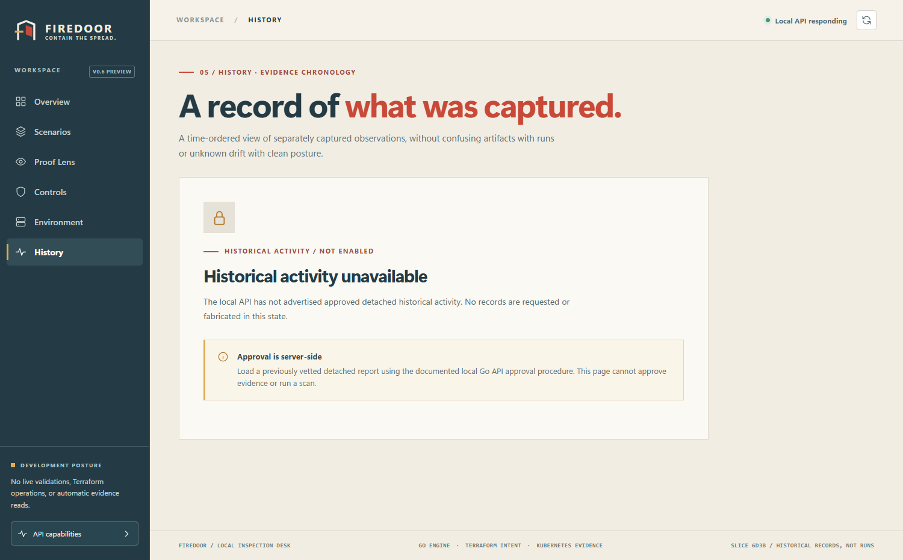
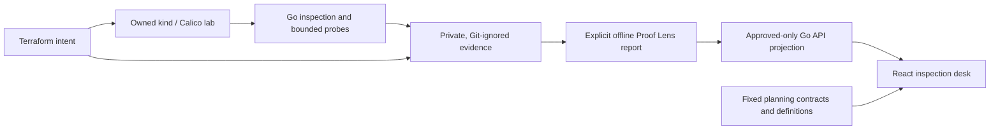

# FIREDOOR

**Contain the spread. Prove the boundary.**

**Firedoor is a local-first Kubernetes security engineering lab and evidence inspection desk.** It combines a Go security CLI, a dedicated kind/Calico testbed, Terraform-managed configuration, bounded network observations, and a React console. Its core design rule is simple: **a security control's intention, a Kubernetes configuration, an observed connection, and proof of enforcement are not the same thing.**

> **Current status — November 9, 2026:** The **v0.6 read-only console** was merged to `main` through PR #7. **v0.7 Containment Map** development is underway on `feat/v07-containment-map` (through 7E2B, `5660680`, with green Go, React and Terraform CI). The v0.7 feature branch has **not been merged or released**. This is a controlled educational/portfolio project, **not** a production scanner, continuously running monitor, independent attestation, or certified security assessment.

## See the system in action

[](docs/screenshots/01-overview-default.png)

*Actual Firedoor console running in **default local read-only mode**. Green local API status means the process responds, **not** that Kubernetes security controls are enforced.*

**Explore default-mode screens:** [Scenarios — five NOT TESTED planning contracts](docs/screenshots/02-scenarios-contracts.png) · [Controls — six NOT EVALUATED definitions](docs/screenshots/03-controls-definitions.png) · [History — locked until explicit approval](docs/screenshots/04-history-locked.png).

<details>
<summary>Preview more console screenshots</summary>

### Scenario contracts

[](docs/screenshots/02-scenarios-contracts.png)

### Security control definitions

[](docs/screenshots/03-controls-definitions.png)

### Historical activity locked by default

[](docs/screenshots/04-history-locked.png)

</details>

These screenshots contain **no private historical report** and can be reproduced from a clean local clone. Optional historical views require separately vetted, Git-ignored evidence and are intentionally **not** included in this public gallery. See the [demo guide](docs/v06-console-demo-guide.md) for review criteria.

### v0.7 Containment Map — development preview (feature branch)

The new **Containment Map** shows three **declared** lab zones and six **planning-only** directional routes for baseline and hardened profiles. Its selection highlight is not a packet trace. All routes remain **NOT ASSESSED** until separately collected evidence can support an appropriately limited conclusion. The optional **Saved network observations** section remains locked by default; even an approved historical readout cannot establish independent NetworkPolicy enforcement. A green local API indicator is *process health*, not Kubernetes health.

From a default-mode local instance, open [the Containment Map preview](http://127.0.0.1:5173/?view=containment), or use **Containment Map** in the sidebar. The fixed `?view=containment` query selects an initial screen only; it does not authorize network requests, historical evidence, or data collection. A reproducible *review-only* browser screenshot can be captured on Windows with `scripts/v07/Capture-FiredoorV07Default.ps1` after starting the ordinary Go API and Vite. It is saved in Pictures, outside Git. **Only add a sanitized screenshot to the public README after individual review.** See [v0.7 capture and PR-readiness instructions](docs/v07-containment-map-slice7e2c.md).

The console is designed to make evidence provenance, unknowns, and security limits as visible as the results. It has seven primary workspaces plus a detailed API capabilities screen.

| Workspace | What you can inspect | What it **doesn't** claim |
| --- | --- | --- |
| **Overview** | Local API health, scenario contract count, feature availability | Cluster health, scenario execution |
| **Scenarios** | Five versioned FD-001–FD-005 *planning* contracts | Certified attack simulations or pass/fail results |
| **Containment Map (v0.7 branch)** | Three declared zones, six directional planning contracts and optional separately gated historical readout | Measured current connectivity, applied policy, or verified enforcement |
| **Proof Lens** | Explicitly approved, detached historical summary | Independently authenticated containment proof |
| **Controls** | Six Go-backed security-control **definitions** | Live control findings or a security score |
| **Environment** | Approved historical Kubernetes snapshot with capture provenance | Current cluster inventory or verified enforcement |
| **History** | Four independently captured historical artifacts in a timeline | Four executed runs or assessed configuration drift |

The **History** page reports **INCONCLUSIVE** and **drift NOT ASSESSED** because these records do not contain a legitimate before/after inventory comparison. No fake green dashboards or placeholder security scores are substituted for missing evidence.

**[Run the local demo](docs/v06-console-demo-guide.md)** · **[Architecture and trust boundaries](docs/architecture.md)** · **[Security and lab scope](SECURITY.md)**

### Console quickstart — Windows PowerShell 5.1

Requires **Go 1.27**, **Node.js 22+**, npm, and Git. The read-only console does **not** require Docker, kind, Terraform, a cluster, SQLite, or an evidence file just to display its default planning contracts. Run from the repository root; two shells must stay open.

```powershell
# One-time dependencies from the repository root
cd "$HOME\Projects\firedoor"
go mod download
cd .\apps\console
npm ci
```

**Terminal `api` — local Go API:**

```powershell
cd "$HOME\Projects\firedoor"
go run ./cmd/firedoor console-api serve
```

**Terminal `react` — development console:**

```powershell
cd "$HOME\Projects\firedoor\apps\console"
npm run dev
```

Open **http://127.0.0.1:5173/**. The Vite development server and Go API bind to loopback interfaces (`127.0.0.1:5173` and `127.0.0.1:8787`). The default mode exposes only fixed, read-only contracts; **historical proof, environment snapshot, and activity are unavailable**. `Ctrl+C` stops either server. A third terminal named `other` is useful for tests and Git.

**Approved historical demo (optional, separate mode):** Only after independently reviewing an existing, Git-ignored, detached report at `docs/evidence/local/v06-console-proof-report.json`, stop the default API. In `api`, from the repository root, run:

```powershell
# First validate the exact fixed local report without opening a server.
go run ./cmd/firedoor console-api inspect-approved-proof `
  --consent I-APPROVE-FIREDOOR-V06-LOCAL-PROOF-VIEW

# If accepted, explicitly start the approved historical-only API.
go run ./cmd/firedoor console-api serve `
  --enable-approved-proof `
  --consent I-APPROVE-FIREDOOR-V06-LOCAL-PROOF-VIEW
```

Refresh Chrome and deliberately choose **Load** on the historical pages. There is **no automatic evidence import by browsing**. If the fixed report is absent or fails consistency checks, approved mode refuses to start. This consent is **not authentication or OS privilege elevation**; do not expose the service to untrusted local users. See the [walkthrough](docs/v06-console-demo-guide.md) before sharing any screenshots.

### Run source-quality checks

```powershell
cd "$HOME\Projects\firedoor"
go test ./...
go vet ./...
go mod verify

cd .\apps\console
npm run typecheck
npm test
npm run build
```

At the 6E2B checkpoint, the local Windows run passed the Go suite, TypeScript, **47/47 Vitest tests**, and the Vite production build. The GitHub Actions workflow now defines separate **Go, Terraform, and React console quality jobs** (locked npm install, TypeScript, Vitest and frontend build). **These are source-quality gates, not live Kubernetes/Calico enforcement tests.** An actual green GitHub Actions run on the proposed PR must be verified before merging; a workflow definition alone is not a successful CI run.

## What makes Firedoor different

Firedoor separates **four evidence layers**:

1. **Declared intent — Terraform.** A single local Terraform state describes the synthetic `edge`, `app`, and `data` Kubernetes workloads and their scoped policies. Plan receipts are plans, **not proof of applied changes**.
2. **Observed configuration — Go inspection/audit.** Scoped read-only Kubernetes inventory and control evaluators produce evidence-backed pass/fail/unknown outcomes. Missing RBAC evidence stays **UNKNOWN**.
3. **Observed behavior — guarded Go probes and historical witnesses.** Explicitly authorized tests collect bounded HTTP observations in the owned lab. Unreachable traffic does not by itself establish CNI or NetworkPolicy causation.
4. **Evidence interpretation — Proof Lens and console.** A consent-gated detached historical projection is checked for consistency, then minimized and displayed with provenance. The browser does not run the earlier collection workflows.

This architecture favors truthful uncertainty over a visually impressive but misleading security score.



The diagram is a conceptual workflow, **not an automatic job graph**. Importing the detached report requires explicit operator approval, and the React app never initiates the left-hand collection or mutation steps.

## Verified local milestones and limitations

| Milestone | Local result | Evidence qualification |
| --- | --- | --- |
| **v0.1** testbed | Three-zone synthetic kind/Calico lab; baseline six reachable routes, hardened profile four reachable / two unreachable | Controlled point-in-time HTTP observations, not independent policy causation |
| **v0.2** controls | Eighteen hardened audit findings: **14 PASS, 1 FAIL, 3 UNKNOWN** | Edge ingress isolation finding and effective RBAC unknowns intentionally retained |
| **v0.3** verification | Six fixed-route observations matched the hardened plan | Offline verification of saved JSON, not continuous or authenticated attestation |
| **v0.4** attribution | Two historical A/B/A witnesses observed unreachable → reachable → unreachable, with recovery checks | Network observations and recovery, not independently proven causation |
| **v0.5** Proof Lens | Receipt, snapshot and witness context combined with **INCONCLUSIVE** verdict | Historical artifacts are not a single causal proof chain |
| **v0.6** console | Read-only workspace views, fixed local API and consent-gated detached history; PR #7 merged | No scenario certification or live cluster inspection through HTTP |
| **v0.7** Containment Map (feature branch) | Three declared zones, six interactive planning routes, optional approval-gated historical observations; 81 frontend tests at 7E2B | Historical connectivity is not authenticated policy enforcement; v0.7 is not merged |

The **five FD scenario contracts remain NOT TESTED** in the v0.6 browser. The control catalog shows definitions, **not** the historical v0.2 audit results. Detailed reproducibility notes: [v0.1](docs/v01-validation-summary.md), [v0.2](docs/v02-validation-summary.md), [v0.3](docs/v03-validation-summary.md), [v0.5](docs/v05-validation-summary.md), and [v0.6 slice history](docs/v06-console-slice6e1b.md).

## Repository map

| Path | Responsibility |
| --- | --- |
| `cmd/firedoor/`, `internal/cli/` | Go/Cobra commands, including `doctor`, `inspect`, `audit`, `verify`, `attribution`, `proof`, and `console-api` |
| `internal/api/` | Fixed localhost GET contracts, minimized projections, request guards |
| `internal/kubeinspect/`, `internal/controls/`, `internal/audit/` | Scoped Kubernetes configuration snapshots and evidence-aware controls |
| `internal/liveverify/`, `internal/attribution/` | Guarded local observations, offline verification and historical A/B/A attribution |
| `internal/prooflens/`, `internal/evidence/` | Receipt and proof consistency, local evidence models and import checks |
| `apps/console/` | React 18, TypeScript, Vite and Vitest read-only inspection desk |
| `infrastructure/bootstrap/`, `infrastructure/terraform/` | Dedicated kind/Calico setup and single-state Terraform testbed |
| `scenarios/FD-001`–`FD-005` | Planning-only scenario contracts |
| `scripts/v06/`, `scripts/v07/` | Source validation gates and opt-in default-mode screenshot capture; no automatic live environment mutations |
| `docs/`, `.github/workflows/` | Architecture, safety boundaries, historical milestone evidence and source CI |

## Safety, scope and next work

- The default console uses a fixed GET-only local API allowlist; v0.7 adds two planning-map routes and a separately gated historical-map route. No credentials, redirects, or implicit historical reads are permitted. Local loopback reduces exposure but is **not** user authentication.
- Only the dedicated owned lab may be used for historical live probes or policy experiments, each requiring their own explicit safeguards. Never point these workflows at third-party or production workloads.
- Do not commit `docs/evidence/local/`, `.tfstate`, generated `.tfplan`, kubeconfig, credentials, or local receipts. A clean clone intentionally **cannot** reproduce your private historical timeline without a separate vetted report.
- The UI does not implement Terraform `apply`, admission enforcement, live Kubernetes inventory, scenario execution, continuous scanning, or measured drift.
- **Next:** v0.7 default-mode screenshot review, accessibility and narrow-viewport smoke checks, updated documentation, and a green feature-branch PR readiness review. Independent policy attribution remains future research, not a shipped feature.

Read [START-HERE.md](START-HERE.md) for the workstation entry point, [SECURITY.md](SECURITY.md) for the trust policy, and the [original master plan](docs/planning/Firedoor_Master_Build_Plan_v1.1.pdf) for design goals. Built for controlled security engineering research. [MIT License](LICENSE).
