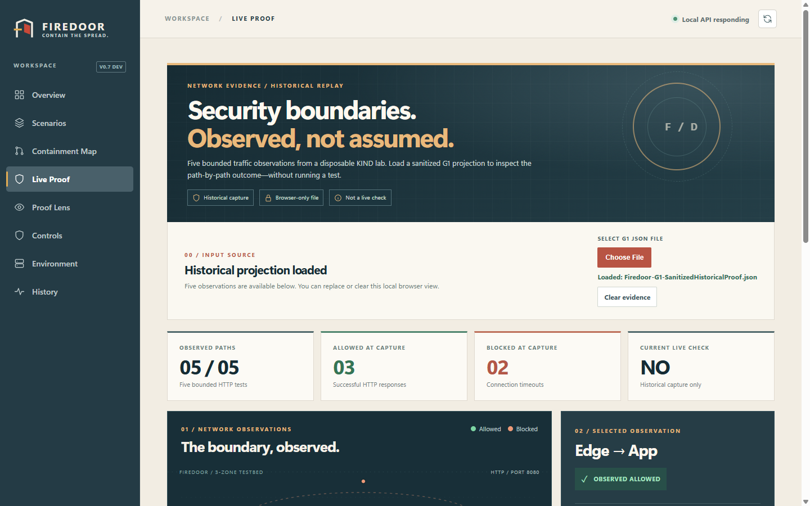
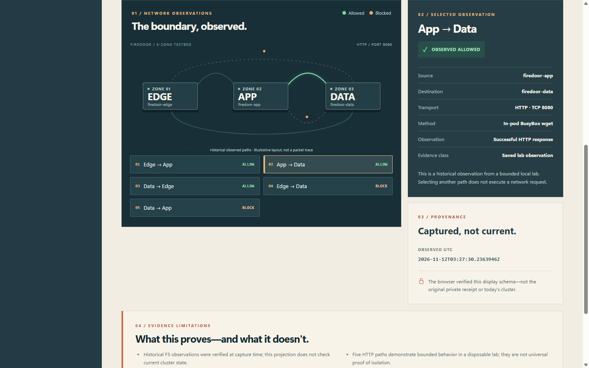
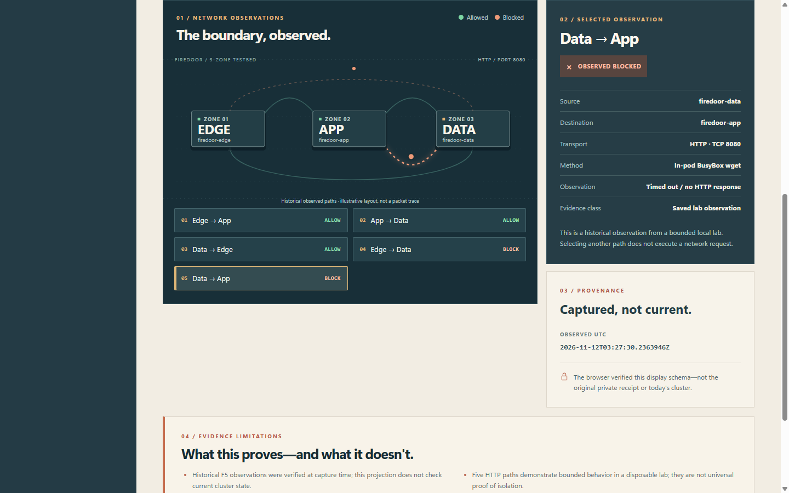

# Firedoor

**Kubernetes policies say what *should* happen. Firedoor checks what *actually* happens.**

Firedoor is a local-first security validation lab built with **Go, Terraform, Kubernetes (kind + Calico), and React**. It connects three things that are often shown separately: **deployment intent, the resources actually running, and observed network traffic**.

In a disposable lab, Firedoor deployed and independently audited **14 Kubernetes resources**, then tested five real HTTP paths: **three reached their destination; two timed out as expected**. Its console lets you inspect the saved results without pretending they're a live scan.



*Real console screenshot using a sanitized historical result. The browser does not run Kubernetes tests or inspect current cluster state.*

## Why it matters

A NetworkPolicy can look correct in YAML and still fail to protect the traffic path you care about. Firedoor makes the boundary testable: deploy to an isolated lab, verify the workloads and policies, run controlled requests, and keep a reviewable record of the outcome.

### What the lab observed

| Traffic path | Result at capture | Why it matters |
| --- | --- | --- |
| Edge → App | **Allowed** | Intended application access works |
| App → Data | **Allowed** | Intended data access works |
| Data → Edge | **Allowed** | Positive connectivity control |
| Edge → Data | **Timed out** | No direct edge-to-data path observed |
| Data → App | **Timed out** | Reverse data-to-app path did not respond |

<details>
<summary><strong>See allowed and blocked path screenshots</strong></summary>

**Allowed: App → Data**



**Blocked: Data → App**



</details>

## What I built

- **Go validation and safety gates** for guarded plans, explicit operator consent, independent evidence checks, and fail-closed execution.
- **Terraform + kind + Calico testbed** with Edge, App, and Data workloads and scoped Kubernetes ingress policies.
- **Post-deployment audit and real traffic probes** to distinguish configured resources from measured behavior.
- **React inspection console** with an interactive network diagram, route details, timestamps, and clear historical-evidence labeling.

The flow is **intent → guarded deployment → independent audit → five HTTP probes → private proof → sanitized console view**. These are separately authorized steps, not operations triggered by viewing the dashboard.

## Try the read-only console

Requires **Go 1.27** and **Node.js 22+**. A Kubernetes cluster is **not required** just to open the interface.

```powershell
# Terminal 1 — repository root
go run ./cmd/firedoor console-api serve

# Terminal 2 — repository root
cd apps/console
npm ci
npm run dev
```

Open **http://127.0.0.1:5173/**. To view saved network evidence, open **Live Proof** and choose a *sanitized G1 historical projection* created from your own verified private receipt. [Projection instructions](docs/v10-live-proof-console-projection.md). Real receipts and the screenshot's JSON are deliberately **not committed**. You can clear the selected file at any time.

## Evidence boundaries

The five paths were observed in a **local disposable lab on November 12, 2026**; two timeouts are consistent with the intended restrictions but do not alone establish universal policy causation or isolation. The console validates the imported display data, **not today's cluster health**. Firedoor does not claim continuous monitoring, production assurance, or proven disaster recovery.

**Explore the engineering:** [Architecture](docs/architecture.md) · [Independent resource audit](docs/v10-fd004-post-apply-read-only-audit.md) · [Live traffic proof](docs/v10-fd004-live-network-enforcement-proof.md) · [Getting started](START-HERE.md) · [Security](SECURITY.md)
