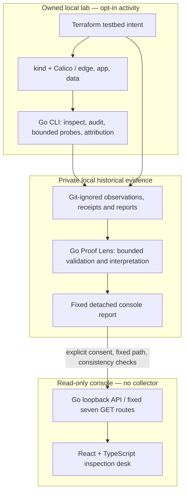

# Firedoor architecture — implemented components and trust boundaries

**Updated for v0.6 local preview, November 6, 2026.** The initial v0.0 sketch described a future API and console; those now exist. This document distinguishes working source interfaces from planned integrations. The current feature branch is `feat/v06-console` and must still pass the final PR/merge review.

## Three separate execution boundaries

The diagram is a **documentation map, not an automatic execution pipeline**. In particular, loading a webpage does not launch a Kubernetes query, Terraform plan/apply, historical probe, SQLite access, or proof collection. The detached proof import occurs at API start after explicit operator approval.

## 1. Testbed and command-line engineering

- **kind** owns cluster lifecycle; **Calico** supplies the chosen local CNI; **Terraform** owns the long-lived synthetic workloads and NetworkPolicy resources. No general-purpose production controller is present.
- The Go CLI handles separate jobs. `inspect` and `audit` perform scoped **read-only** Kubernetes configuration evaluation; opt-in probe/attribution tooling has additional owned-context, namespace, Pod/route and recovery protections. These are **not HTTP endpoints**.
- v0.2 local audit retained 14 PASS, 1 FAIL and 3 UNKNOWN findings. v0.3 historical HTTP verification matched six fixed expectations. v0.4 A/B/A witnesses and v0.5 Proof Lens remain narrowly scoped evidence, not independently authenticated enforcement conclusions.
- Local evidence, Terraform state and credentials are **not source assets** and are Git-ignored; original evidence is not served by the console API.

## 2. The loopback Go API

Implemented in [`internal/api`](../internal/api) and the [`console-api` Cobra command](../internal/cli/console_api.go). Listener is fixed to `127.0.0.1:8787`; there is no user-controlled bind address or generic file-selection flag. The HTTP handler has no Kubernetes, Terraform, database or filesystem clients. Requests are GET-only and restricted by Host/Origin and fixed path rules. Responses are `no-store`, with relevant browser-protection headers.

| HTTP route | Default mode | Approved detached mode | Meaning |
| --- | --- | --- | --- |
| `GET /api/v1/health` | Available | Available | Local **process** response; no cluster check |
| `GET /api/v1/capabilities` | Available | Available | Fixed feature/mode advertisement |
| `GET /api/v1/scenarios` | Available | Available | Five **planning-only** FD contracts |
| `GET /api/v1/control-catalog` | Available | Available | Six static control definitions, no findings |
| `GET /api/v1/proof-summary` | Unavailable | Available | Minimized historical **INCONCLUSIVE** interpretation |
| `GET /api/v1/environment-snapshot` | Unavailable | Available | Approved **historical** Kubernetes snapshot |
| `GET /api/v1/historical-activity` | Unavailable | Available | Four historical artifacts; drift **NOT ASSESSED** |

The only approved import path is `docs/evidence/local/v06-console-proof-report.json`, with explicit `--enable-approved-proof` and exact `--consent`. The CLI validates it **before** binding its listener, produces an in-memory minimized projection, and rejects missing/inconsistent input without opening approved endpoints. `console-api inspect-approved-proof` performs a separate classification-only check and does not start a server.

**Threat-model limitation:** `127.0.0.1` and an exact consent string are **not authentication**, authorization, encryption, independent integrity attestation, or protection against other local processes/users. Operate only in a trusted local development context. Browser access is not intended for remote or production deployment.

## 3. React/Vite inspection desk

Implemented in [`apps/console`](../apps/console) with React 18, TypeScript and Vite. The Vite development proxy forwards **only seven exact paths** to the Go server. The browser client uses bounded (32 KiB), strict JSON validation, an eight-second request deadline, credential omission, redirect rejection and navigation cancellation. There is no automatic fallback dataset on API failure.

Six main workspaces: Overview, Scenarios, Proof Lens, Controls, Environment and History. An additional API capabilities view is available from the sidebar. The keyboard-accessible scenario drawer, skip-to-main navigation and explicit historical-load buttons preserve accessibility and consent semantics. In default mode, historical pages are visibly locked. In approved mode, the user must still click to request each historical view.

Each visual status has a specific scope: **ONLINE** means an HTTP process responded; **NOT TESTED** means a scenario contract was never executed; **NOT EVALUATED** describes the static control catalog; **INCONCLUSIVE** is the detached Proof Lens interpretation; **NOT ASSESSED** is absence of comparable drift evidence. These statuses are intentionally not interchangeable.

## 4. Boundaries that must not be crossed

| Inference | Supported? | Why |
| --- | --- | --- |
| A policy object exists, therefore it blocked traffic | **No** | CNI/effective-policy attribution is not independently established by object presence |
| An application connection timed out, therefore the policy caused it | **No** | Other failure paths remain possible; v0.4 witnesses are historical |
| One Kubernetes snapshot shows no configuration drift | **No** | Drift needs at least two comparable, credibly sourced observations |
| A speculative Terraform plan proves changes were applied | **No** | The plan was not applied in the detached report |
| Six control definitions represent six passing controls | **No** | Definitions are not findings; the v0.2 audit is a separate CLI workflow |
| Four historical records represent four Firedoor execution runs | **No** | Separate artifacts were recorded at distinct times |
| API health says the cluster is healthy | **No** | The API health response explicitly does not check Kubernetes |

## 5. Validation and review status

On the developer workstation, v0.6 through 6E1B passed `go test ./...`, `go vet ./...`, `go mod verify`, TypeScript typecheck, 47 Vitest tests and a Vite build. The observed browser checks included locked/approved historical states and API-offline recovery. These are **local developer results**, not third-party or production assessments.

GitHub Actions currently runs Go formatting/test/vet/build and Terraform formatting/validation on the relevant branches. React test integration into CI and the v0.6 feature PR/merge remain review work. For a safe live walkthrough, use [`v06-console-demo-guide.md`](v06-console-demo-guide.md); for historical findings, see the v0.1–v0.5 validation summaries and [`SECURITY.md`](../SECURITY.md).
